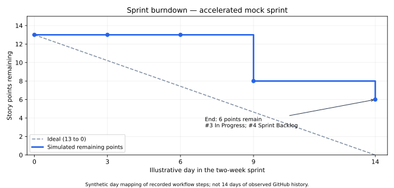

# Scrum Project — Assignment 12.1

**[Open the public Kanban board](https://github.com/users/Kr1sKros/projects/3/views/2)**

An AI-assisted solo Scrum exercise for an e-commerce product catalog. This repository contains planning artifacts and an accelerated mock sprint, not a working backend.

- [Two-page assignment report (PDF)](docs/assignment-report.pdf)
- [Report text](docs/assignment-report.md)
- [Refinement, sprint planning and simulation record](docs/ceremonies-and-simulation.md)
- [Sprint milestone](https://github.com/Kr1sKros/agile-project/milestone/1)
- [Ten user stories](https://github.com/Kr1sKros/agile-project/issues?q=is%3Aissue)
- [User story template](.github/ISSUE_TEMPLATE/user-story.md)

## Sprint snapshot

Sprint: **12–25 November 2026**, ending 26 November (14 calendar days). Goal: basic catalog CRUD. Estimates: create 5, retrieve 2, update 3, delete 3 = **13 points**.

| Column | Stories |
|---|---|
| Icebox | #7 List all products; #8 Query a subset |
| Product Backlog | #5 Like; #6 Dislike; #9 Cloud hosting; #10 Automated deployment |
| Sprint Backlog | #4 Delete (3 points) |
| In Progress | #3 Update (3 points), assigned @Kr1sKros |
| Review/QA | Empty at the end of the simulation |
| Done | #1 Create (5 points); #2 Retrieve (2 points), assigned @Kr1sKros |

The initial Product Backlog order was #1, #2, #3, #4, #5, #6, #9, #10. Backlog Rank preserves the order. The first four stories moved into the sprint. The top five have Gherkin acceptance criteria; all ten have user stories and labels. No backend or cloud resources were deployed.

## Simulated burndown

[CSV source](docs/burndown.csv). Days are illustrative mappings of mock checkpoints, not two weeks of observed GitHub history. Remaining points = 13 − points of Done stories. GitHub issue comments record actual transition times. Done/closed means simulated completion for this exercise.

## Peer review

Share this public URL: **https://github.com/users/Kr1sKros/projects/3/views/2**. Review the ten stories, top-five criteria, labels, estimates, milestone, final columns and burndown. No invitation or message has been sent to peers.

## Sources

- Assignment 12.1 instructions supplied by the student.
- [Paperflite: What is a Product Catalog?](https://www.paperflite.com/blogs/product-catalog)
- [GitHub Docs: About insights for Projects](https://docs.github.com/en/issues/planning-and-tracking-with-projects/viewing-insights-from-your-project/about-insights-for-projects)

The course videos and separate sharing-link example were not provided. This setup follows the written task list.
