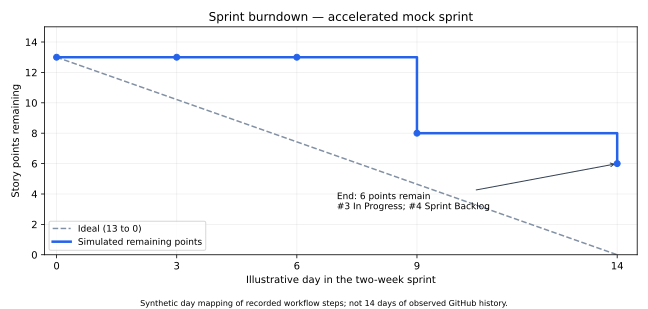

Assignment 12.1 — Scrum project

Krzysztof Manczak (@Kr1sKros) | 12 November 2026

Kanban board: https://github.com/users/Kr1sKros/projects/3/views/2

Repository: https://github.com/Kr1sKros/agile-project

What was done

A public agile-project repository and a public, repository-linked Scrum Project were created for an e-commerce backend catalog. The board has Icebox, Product Backlog, Sprint Backlog, In Progress, Review/QA and Done columns. An issue template standardizes As a / I need / So that stories, assumptions, Gherkin criteria and the Definition of Done. Ten issues represent the ten stakeholder requirements.

This was an AI-assisted solo simulation using @Kr1sKros. Product owner, scrum master, customer and developer perspectives were role-played; no real group meeting or customer contact is claimed. Done indicates simulated workflow completion, not implemented or tested backend software.

Backlog refinement

Requirements #7 (list products) and #8 (query a subset) were moved to Icebox. The other stories were placed in Product Backlog in this order: #1 create, #2 retrieve, #3 update, #4 delete, #5 Like, #6 Dislike, #9 cloud hosting and #10 automated deployment. A numeric Backlog Rank preserves this priority after sprint selection. CRUD comes first because subsequent features depend on catalog records.

The top five stories received Given / When / Then acceptance criteria, including successful operations and invalid or missing-product cases. For example, creating a valid product returns HTTP 201 with a unique ID; a missing name or negative price returns HTTP 400 without creating a record. Stories #1–#8 use enhancement; #9–#10 use the new technical debt label for enabling infrastructure work.

Sprint planning

The Sprint milestone covers 12–25 November 2026 inclusive, ending at 26 November 00:00 UTC: a two-week timebox. The goal is to establish basic catalog CRUD capabilities. The first four stories were assigned to Sprint and moved to Sprint Backlog. Estimates were #1 create: 5 points; #2 retrieve: 2; #3 update: 3; #4 delete: 3, totaling 13 points. Creation was larger because it combines input validation, persistence and identifier generation.

These are relative estimates and an illustrative capacity assumption, not hours or measured team velocity. Sprint readiness requires a clear story, testable acceptance criteria and an estimate. Real completion would also require passing tests, code review and updated API documentation. Planning decisions and transition evidence are recorded in the repository and issue comments.

Execution, evidence and reflection

Simulated sprint

First, #1 was assigned to @Kr1sKros and moved to In Progress. Next, #1 moved to Review/QA while #2 was assigned and started. Then #1 moved to Done, #2 moved to Review/QA, and #3 was assigned and started. Finally, #2 moved to Done. The exercise stopped with #3 still In Progress and #4 still in Sprint Backlog, exactly as requested. Review/QA is empty. Issues #1 and #2 were closed to match Done.

Burndown and outcome

Only fully Done stories reduce remaining points. The five checkpoints have 13, 13, 13, 8 and 6 points remaining. Therefore 7 of 13 points (53.8%) were completed in the mock sprint, leaving 6 points. Partial progress on #3 receives no completion credit. The chart compares remaining work with an ideal decline from 13 to zero.

The chart uses illustrative day offsets 0, 3, 6, 9 and 14 for the ordered checkpoints. All actual GitHub transitions happened during setup. This is synthetic sprint timing, not historical daily observations. GitHub documents a native burn-up chart; a clearly labeled burndown SVG/PNG and its CSV source are supplied in the repository instead.

Challenges and lessons

The main challenges were making broad requirements testable, estimating without team velocity, and distinguishing Dislike from removing a Like. A one-reaction-per-shopper/product rule was recorded as an assumption for later refinement. The exercise also required separating simulated QA from proof of working software and adapting the burndown requirement to GitHub analytics.

The final snapshot shows why started work is not completed work. A future planning session should reassess #3 and #4 before adding scope. Maintaining explicit priority, clear acceptance criteria and a visible review stage made handoffs understandable. The public board URL above is ready to share for peer review; no peer review has been claimed.

References: assignment instructions; Paperflite, “What is a Product Catalog?”; GitHub Docs, “About insights for Projects.” Clickable sources and detailed simulation data are in docs/ceremonies-and-simulation.md.

